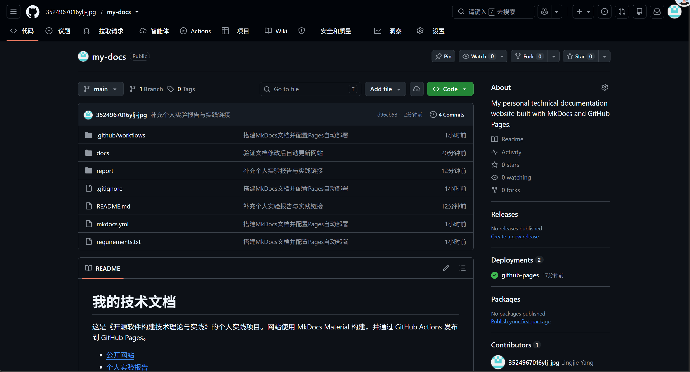
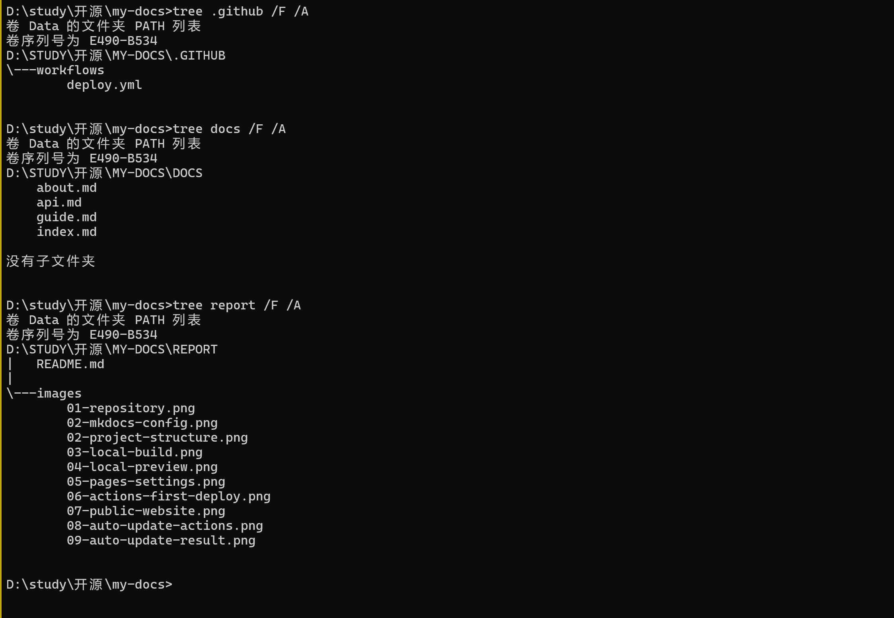
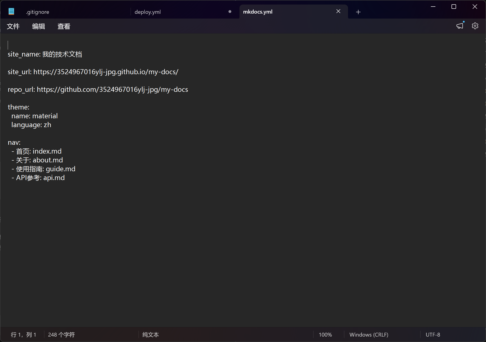
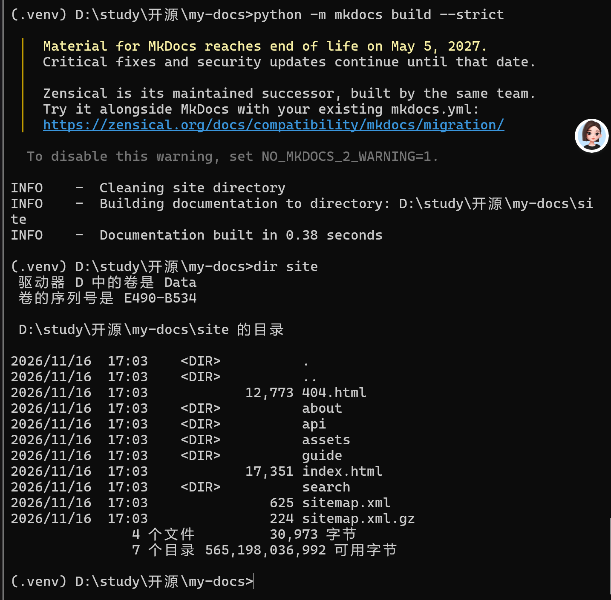
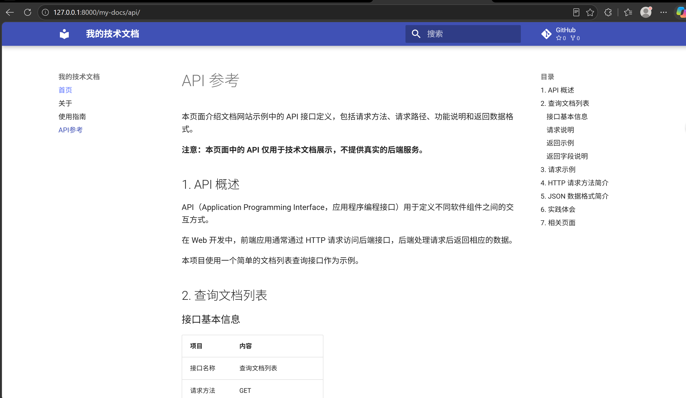
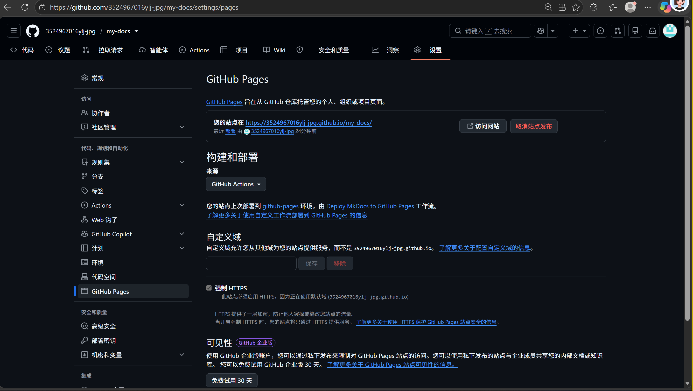
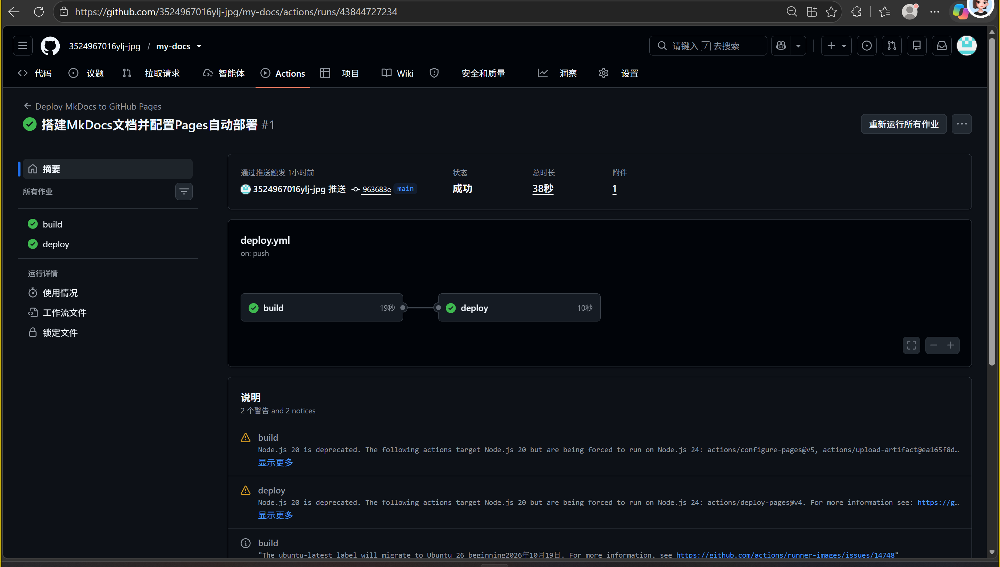
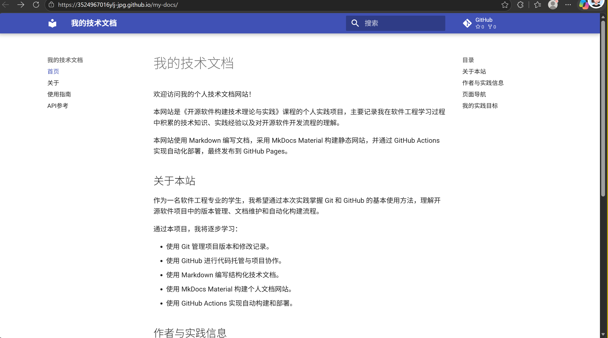
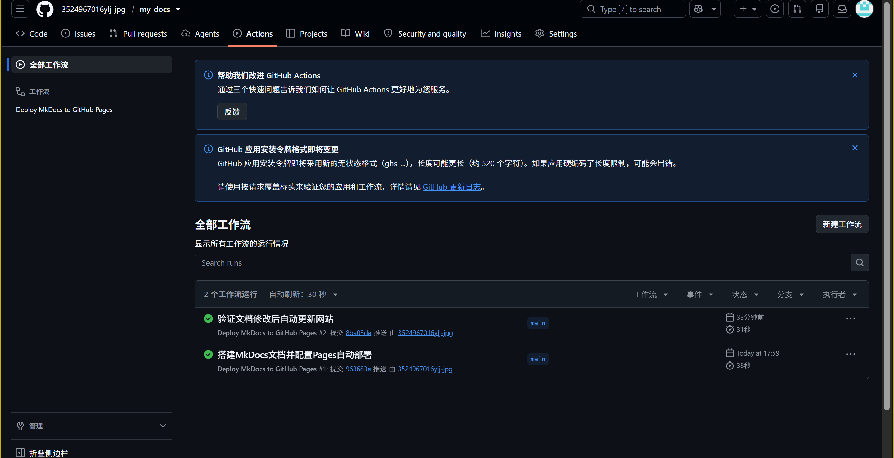
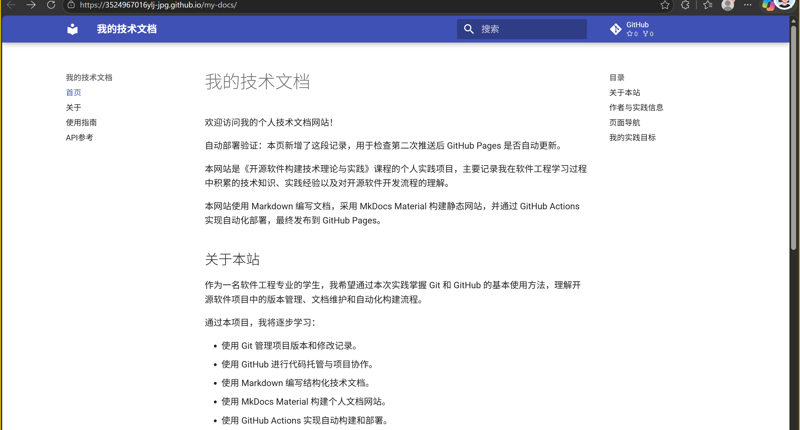

# 实践项目 2：个人实验报告

## 1. 基本信息

- GitHub 登录名：`3524967016ylj-jpg`
- [个人源码仓库](https://github.com/3524967016ylj-jpg/my-docs)
- [公开网站](https://3524967016ylj-jpg.github.io/my-docs/)
- [首次部署运行记录](https://github.com/3524967016ylj-jpg/my-docs/actions/runs/43844727234)

## 2. 实践过程与证据

### 2.1 个人仓库

我使用自己的 GitHub 账号创建了公开仓库 `my-docs`，以 `main` 为源码分支。仓库地址见上方链接。

截图显示仓库所有者、`my-docs` 名称、`Public` 标识及项目文件。

### 2.2 项目结构与配置

`docs/` 保存四个 Markdown 页面；`mkdocs.yml` 的 `nav` 将它们加入导航，`site_url` 指向项目站点。`site/` 是构建生成的目录，已写入 `.gitignore`，不提交到源码分支。

项目目录截图显示工作流、四个文档页面及报告目录；配置截图显示网站地址、Material 主题和四页导航。

### 2.3 本地构建与预览

我使用 Python 虚拟环境安装依赖，执行 `python -m mkdocs build --strict`。终端显示构建成功，`site/` 中生成了首页及其他页面。构建时还显示 Material 生命周期提示，但没有使本次构建失败。

我用本地预览检查了导航、API 页的表格和页面文字。预览截图的地址栏为本地 `/my-docs/api/`，并非公开网站。

### 2.4 Pages 发布来源

本项目使用 GitHub Actions 上传和部署 `site/` 构建产物。Pages 设置页的“来源”为 GitHub Actions，并显示公开站点地址。

### 2.5 首次自动部署

提交 [`963683e`](https://github.com/3524967016ylj-jpg/my-docs/commit/963683e) 推送到 `main` 后，首次[工作流运行](https://github.com/3524967016ylj-jpg/my-docs/actions/runs/43844727234)显示 `build` 和 `deploy` 均成功，并给出网站地址。运行中有 Node.js 20 与运行器迁移提示，未阻止此次部署。

### 2.6 公开网站与四页导航

站点地址为 [https://3524967016ylj-jpg.github.io/my-docs/](https://3524967016ylj-jpg.github.io/my-docs/)。截图保留了公开网站地址栏和四页导航。第二次部署后，我检查了首页、关于、使用指南和 API 参考四个地址，均正常返回；首页 HTML 已包含新增的“自动部署验证”文字。

### 2.7 第二次推送自动更新

我在 `docs/index.md` 增加可辨认的“自动部署验证”文字，并将提交 [`8ba03da`](https://github.com/3524967016ylj-jpg/my-docs/commit/8ba03dacd8c3e23156de4503a2c2cfd54f1f484d) 推送到 `main`。这次 `push` 自动触发了[第二次工作流运行](https://github.com/3524967016ylj-jpg/my-docs/actions/runs/43855835222)，`build` 和 `deploy` 均成功。随后检查公开首页，确认新增文字已经出现，没有手动触发部署。

- 第二次提交链接：[8ba03da](https://github.com/3524967016ylj-jpg/my-docs/commit/8ba03dacd8c3e23156de4503a2c2cfd54f1f484d)
- 对应 Actions 运行链接：[第 2 次自动部署](https://github.com/3524967016ylj-jpg/my-docs/actions/runs/43855835222)
第二次运行列表截图显示提交 `8ba03da` 对应的运行 `#2` 成功，公开网站截图显示新增验证文字。

## 3. 问题与解决

本地构建出现 Material 生命周期提示，但命令仍正常完成。首次 Actions 运行中的 Node.js 与运行器提示也未造成任务失败。我核对了工作流中的 Python 版本、构建命令、部署权限和 `build`、`deploy` 两个任务的执行状态。后续若部署失败，应先进入具体失败步骤查看日志，再对照配置和依赖定位原因。

## 4. 原理理解

1. `docs/` 是人工维护的 Markdown 源文件；`site/` 是 MkDocs 根据源文件和配置生成的 HTML、样式等产物。修改源文件并重新构建即可更新产物，因此不手工编辑 `site/`。
2. 推送到 `main` 且改动命中 `docs/**`、`mkdocs.yml`、`requirements.txt` 或工作流文件时自动运行；也可以手动触发。
3. `build` 检出源码、安装依赖、严格构建并上传产物；`deploy` 在构建成功后把产物发布到 Pages。
4. 只修改 `report/README.md` 不会触发部署，因为它不在工作流的 `paths` 范围内。
5. 官方 Pages Actions 直接部署上传的 artifact，因此无需创建 `gh-pages` 分支。
